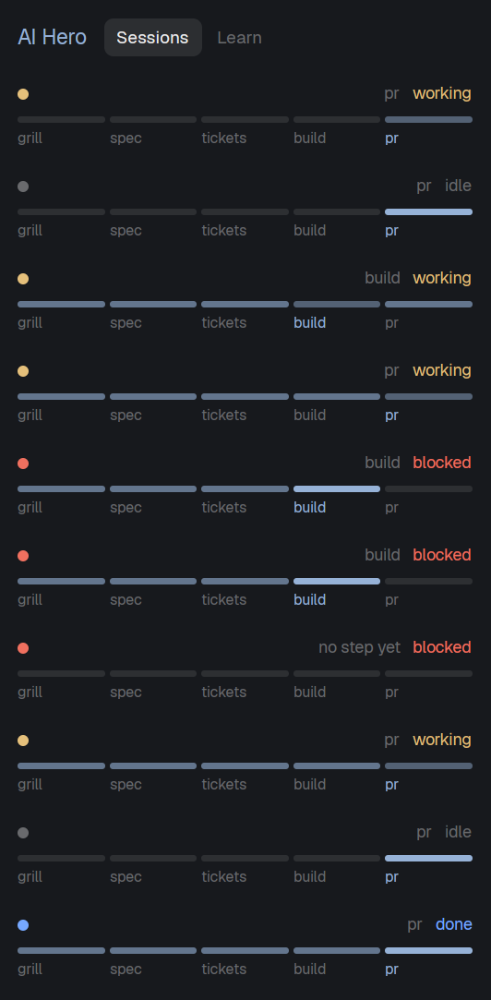

# AI Hero

A 320 px panel docked on the right that shows **which step of Matt Pocock's skill chain each of your agent sessions is on**: grill, spec, tickets, build, pr. Every session is a row with five bars under it; the bar for the step it last used is lit, earlier steps it went through are dimmer. A second tab, Learn, lists [aihero.dev](https://www.aihero.dev)'s latest posts, searches the site, and opens any page as markdown you can hand to an agent.



## What you see

On the theme's `surface` color, 12 px text, top to bottom:

1. **Header**, 12 px padding: `AI Hero` (13.5 px, semibold, `accent`) and two tabs, `Sessions` and `Learn` (11.5 px; the selected one has a `raised` fill and `foreground` text, the other `dim`).
2. **Sessions tab**, scrolling, one row per entry of `agents()` in that order, 12 px side padding, 7 px vertical, `hover` background:
   - a line with a 7 px round dot in the agent's status color (`working`, `blocked`, `done`, `idle` from the theme), the space name (`foreground`, or `accent` when that agent has focus), then on the right the step label (10.5 px, `dim`: `grill`, `spec`, `tickets`, `build`, `pr`, `no step yet`, `reading…`, or `no read` in `blocked` red) and the status word in its status color;
   - under it five equal bars, 4 px high, 2 px radius, 3 px gap, each with its label below (9.5 px): `grill`, `spec`, `tickets`, `build`, `pr`. Bar colors: the current step `accent` at full strength; a step seen earlier `accent` at 60 percent; a step not seen `border`. The current step's label is `accent`, the others `dim`.
   - If any session could not be read, a 10.5 px `blocked` line at the bottom says how many and the first error.
3. **Learn tab:** a 30 px search field (`Search aihero.dev, Enter`), a caption (`Latest` or `<n> results`, 10.5 px `dim`), then a scrolling list: title, and under it, 10.5 px `dim`, the kind (`article`, `skills`, or the search hit's type) and age (`today`, `6d`, `1mo`, `1y`). A red line above the caption shows a failed fetch.
4. **Reader dialog**, 720 × 560, `popover` background, 16 px padding: the title, a `Hand to agent` primary button, a `Close` button, then the page's markdown (scrolling, selectable).

## How it behaves

- **Which step:** a session's step comes from its Claude Code transcript, the newest `*.jsonl` in `~/.claude/projects/<folder with every non-alphanumeric character turned into "-">/` on the agent's machine. In file order, every `<command-name>/NAME</command-name>` (a slash command the person typed) and every `"skill":"NAME"` (a skill Claude invoked) counts. A plugin prefix (`orum:to-spec`) is ignored. Names map to steps: `grill` = grill-me, grilling, grill-with-docs; `spec` = to-spec; `tickets` = to-tickets; `build` = implement, implement-spec, tdd; `pr` = pr. The **current** step is the last such name; **seen** steps are all of them. No folder transcript: `no step yet` (none) is shown when no name matches.
- **When it reads:** at start, then every 20 s it re-reads only agents whose status changed since the last read or whose last read is over 90 s old. Agents on the same machine in the same folder are read once and share the answer (they share a transcript folder, so two agents in one folder show the same step).
- **Working agents:** the current bar pulses (opacity 0.45 to 1, 1.4 s) natively; nothing redraws on a timer.
- **Click a row's top line:** `agent.focus` for that agent.
- **Click a bar:** types `/<command>` and Enter into that session (`/grill-me`, `/to-spec`, `/to-tickets`, `/implement`, `/pr`), only if it is `idle`; otherwise nothing is typed and an error toast says why. Its transcript is re-read right after.
- **Learn:** the feed loads at start and every 30 minutes (articles and the skills changelog, newest first, no repeated titles, 60 max). Typing edits the field; Enter searches (under 2 characters clears). Clicking a row opens the reader. `Hand to agent` types `Read <page-url>.md and apply what it teaches to this repo.` into the focused agent, only if idle, then closes; with no focused agent it shows an error toast.
- No keys are bound.

## Built from

```
mods/hero/
  mod.json   { "place": "right", "size": 320, "title": "AI Hero" }
  main.js    default class Hero extends View. With props().url it draws the reader, else the panel.
  feed.js    pure helpers: STEPS, progress, transcriptCommand, parseRss, parseSearch, mdUrl, ago, stripFrontMatter
tests/feed.test.mjs   node --test tests/
```

- Imports: `View, div` from `gpui-kit`; `v_flex, h_flex, InputState, Input, TextView` from `gpui-base`; `agents, closeOverlay, exec, hc, notify, openOverlay, panes, props, run, spaces, theme` from `herdr`.
- **Programs it runs (tell the person before installing):** `exec` on each agent's machine (`on: space.machine`, 60 s timeout) of a read-only transcript scan: `sh -c` (grep and sed over the newest transcript) for a POSIX folder, `powershell -NoProfile -Command` (a regex over `[IO.File]::ReadLines`) when the folder starts with a drive letter. It reads those transcript files outside the mod's folder and writes nothing. `hc send <address> <text> --if idle` types into an agent.
- **Network (GET, header `User-Agent: herdr-hero-mod/0.1`):** `https://www.aihero.dev/rss.xml`, `https://www.aihero.dev/skills/rss.xml` (RSS 2.0: title, link, pubDate, description; unsorted), `https://www.aihero.dev/api/search?q=<query>` (`{ result: { hits: [{ type, title, url, summary }] } }`), and `<page url>.md` (starts with a `---` YAML front matter block, removed before showing). robots.txt allows them; no login.
- A session's folder is `panes().find(p => p.pane === agent.pane).cwd`, its machine `spaces().find(s => s.id === agent.space).machine`.
- Other commands: `run("agent.focus", { terminal })`, `openOverlay({ mod: "hero", kind: "dialog", width: 720, height: 560, props: { url, title } })`, `closeOverlay(props().overlay)`, `notify({ title: "AI Hero", body, level: "error" })`.
- The five steps are Matt Pocock's skills (github.com/mattpocock/skills, MIT). The sessions need them installed (`claude plugin install mattpocock-skills@claude-plugins-official`); the mod does not install them.

## Watch out

- It only understands **Claude Code** sessions; it reads Claude's transcript folder. Other agents show `no step yet`.
- Two sessions in the same folder cannot be told apart: both show the newest transcript's step.
- Failures are shown, never hidden: a non-zero exit, a timeout or a missing program shows `no read` and the error line; there is no guess. A read that finds no matching names is `no step yet`, which is a result, not an error.
- A first read of a big transcript can take tens of seconds on a slow or Windows machine; rows say `reading…` until it lands.
- `hc send` types and presses Enter; keep `--if idle`.
- The reader opens `mod: "hero"` by name; if the folder is renamed, change that string.
- Do not poll the site faster than every 30 minutes.
- `place: "right"` docks a copy the first time Herdr sees the folder. To try it without docking, copy it to another name with `place: "none"` and open it with `mod.open`.

## Done when

- `herdr-app check mods/hero` passes, `herdr-app status` shows no errors, and `node --test tests/` passes.
- Within a minute every agent row shows a step or `no step yet`, none stuck on `reading…`.
- In a session where you typed `/grill-me` then `/to-spec`, the first two bars are lit (the second at full strength) and the label says `spec`; the other three bars are `border` color.
- Making a session run `/to-tickets` moves its current bar to `tickets` within about 90 s (sooner when its status changes).
- Clicking the `build` bar of an idle session types `/implement` into it; on a working session it types nothing and shows an error toast.
- Learn lists at least 10 rows, no repeated titles; searching `tdd` shows `The /tdd Skill`; a row opens the markdown without front matter; `Hand to agent` types its sentence into the focused idle agent.
- With the network off, Learn shows a red error and Sessions keeps working.
